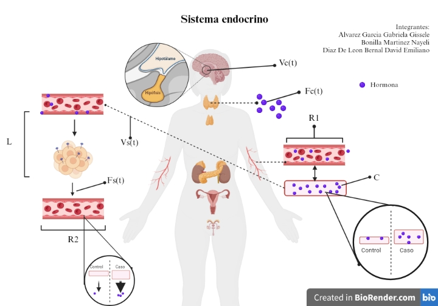
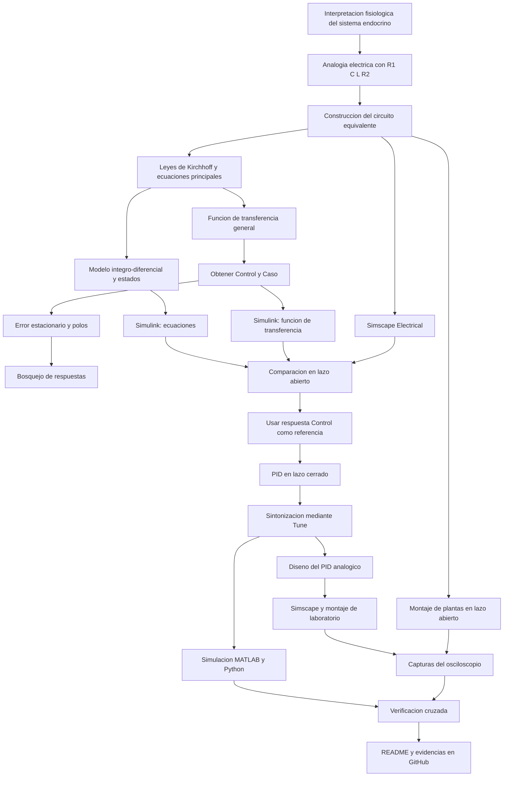

[](https://matlab.mathworks.com/open/github/v1?repo=l22212381-cyber/MSFP4)
# Práctica 4 — Modelado y control del sistema endocrino

Repositorio académico de la asignatura **Modelado de Sistemas Fisiológicos**, del programa de **Ingeniería Biomédica** del Tecnológico Nacional de México / Instituto Tecnológico de Tijuana. En esta práctica se desarrolla una **analogía eléctrica fenomenológica** del sistema endocrino para estudiar la secreción, el transporte, el almacenamiento temporal, la utilización y la respuesta de una señal hormonal mediante un circuito de segundo orden.

Se comparan dos condiciones —**control** (referencia) y **caso** (alterada)— en lazo abierto. Posteriormente se diseña un controlador PID para aproximar la respuesta del caso a la respuesta del control. El trabajo integra formulación matemática, MATLAB/Simulink, Simscape Electrical, Python y verificación experimental en el Laboratorio de Electrónica.

**Docente:** Dr. Paul Antonio Valle Trujillo  
**Correo:** paul.valle@tectijuana.edu.mx  
**Departamento:** Ingeniería Eléctrica y Electrónica  
**Institución:** Tecnológico Nacional de México / Instituto Tecnológico de Tijuana  
**Asignatura:** Modelado de Sistemas Fisiológicos  
**Programa:** Ingeniería Biomédica  
**Estudiante:** Nayeli Bonilla Martínez  
**Número de control:** 22212381  
**Correo institucional:** L22212381@tectijuana.edu.mx  
**Sede:** Blvd. Alberto Limón Padilla s/n, Tijuana, C. P. 22454, B. C., México.

**Repositorio de la asignatura:** https://github.com/DrPaulValle/MSF-IBF1020

---

<a id="contenido"></a>
## Contenido

1. [Resumen](#resumen)
2. [Competencia y objetivos](#objetivos)
3. [Relación con el temario](#temario)
4. [Modelo endocrino y analogía eléctrica](#analogia)
5. [Diagrama biológico](#diagrama-biologico)
6. [Formulación matemática](#modelo)
7. [Error estacionario y análisis de estabilidad](#analisis)
8. [Entrada y condiciones de simulación](#senales)
9. [Implementación en MATLAB, Simulink y Simscape](#matlab)
10. [Control en lazo cerrado y sintonización PID](#pid)
11. [Reproducción en Python](#python)
12. [Controlador analógico y laboratorio](#laboratorio)
13. [Resultados y verificación cruzada](#resultados)
14. [Flujo de trabajo](#flujo)
15. [Actividades de la práctica](#actividades)
16. [Estructura del repositorio](#estructura)
17. [Requisitos](#requisitos)
18. [Reproducibilidad y entregables](#reproducibilidad)
19. [Referencias](#referencias)

---

<a id="resumen"></a>
## 1. Resumen

El sistema endocrino participa en la regulación fisiológica a través de hormonas secretadas por glándulas especializadas. Estas hormonas son transportadas hasta tejidos u órganos diana, donde desencadenan respuestas que pueden presentar almacenamiento temporal, pérdidas, disipación y retardos. Con fines didácticos, la práctica **no modela un eje hormonal específico**: utiliza una representación eléctrica simplificada de estos fenómenos.

El circuito equivalente tiene una fuente de voltaje $V_e(t)$ seguida por una resistencia $R_1$. En el nodo de salida $V_s(t)$ se conectan dos ramas en paralelo: un capacitor $C$ a referencia y una conexión serie de inductancia $L$ y resistencia $R_2$ a referencia. La presencia de $L$ y $C$ origina un **sistema dinámico de segundo orden**.

El desarrollo contempla el cálculo de las funciones de transferencia de las condiciones control y caso, el error ante un escalón unitario, los polos y la estabilidad, la simulación en lazo abierto, el diseño de un PID, la comprobación en MATLAB/Python y la comparación con un montaje experimental.

**Palabras clave:** sistema endocrino; analogía eléctrica; circuito RLC; función de transferencia; estabilidad; PID; MATLAB; Simulink; Simscape Electrical; Python.

[Volver al contenido](#contenido)

---

<a id="objetivos"></a>
## 2. Competencia y objetivos

### Competencia a desarrollar

Modelizar sistemas fisiológicos mediante analogías eléctricas, ecuaciones diferenciales y funciones de transferencia para analizar su comportamiento dinámico y diseñar estrategias de control mediante técnicas de control clásico.

### Objetivo general

Modelar y comparar el comportamiento dinámico de dos condiciones de un sistema endocrino simplificado mediante un circuito eléctrico de segundo orden y diseñar un controlador PID que reduzca la diferencia entre sus respuestas.

### Objetivos específicos

- Interpretar las etapas de secreción, transporte, almacenamiento y respuesta hormonal mediante variables eléctricas.
- Construir el circuito equivalente e identificar sus nodos, corrientes, entrada y salida.
- Derivar las ecuaciones del circuito y obtener su función de transferencia general.
- Obtener las funciones de transferencia de control y caso con los valores establecidos.
- Calcular la respuesta final, el error en estado estacionario y los polos de ambos modelos.
- Simular las condiciones en lazo abierto usando ecuaciones, funciones de transferencia y Simscape Electrical.
- Sintonizar un controlador PID utilizando la respuesta de control como referencia para el caso.
- Comparar los resultados en MATLAB/Simulink, Python y el Laboratorio de Electrónica.
- Documentar los métodos y evidencias en un repositorio GitHub.

[Volver al contenido](#contenido)

---

<a id="temario"></a>
## 3. Relación con el temario

| Área | Contenidos aplicados |
|---|---|
| Modelado de sistemas fisiológicos | Interpretación cualitativa de los procesos endocrinos y analogías eléctricas |
| Circuitos eléctricos | Leyes de Kirchhoff, ley de Ohm y elementos $R$, $L$ y $C$ |
| Sistemas dinámicos | Ecuaciones integro-diferenciales, variables de estado y funciones de transferencia |
| Control clásico | Polos, estabilidad, error estacionario, lazo abierto y lazo cerrado |
| Controladores | Retroalimentación negativa, PID y sintonización mediante **Tune** |
| Herramientas computacionales | MATLAB, Simulink, Simscape Electrical y Python |
| Electrónica experimental | Montajes en protoboard y medición de señales mediante osciloscopio |

[Volver al contenido](#contenido)

---

<a id="analogia"></a>
## 4. Modelo endocrino y analogía eléctrica

La fuente de voltaje representa un estímulo que inicia la secreción hormonal. La resistencia de entrada aproxima las pérdidas u oposición al transporte. El capacitor caracteriza el almacenamiento temporal de la señal hormonal; la inductancia y la segunda resistencia representan, respectivamente, la inercia de la respuesta y la disipación asociada a la utilización o eliminación de la señal.

### Correspondencias fisiológicas y eléctricas

| Variable o proceso fisiológico | Representación eléctrica | Interpretación dentro del modelo |
|---|---|---|
| Estímulo para la secreción hormonal | $V_e(t)$ | Señal de entrada que activa la respuesta del sistema |
| Flujo de secreción y transporte hormonal | $F_e(t)$ | Corriente de entrada por $R_1$ |
| Oposición y pérdidas durante el transporte | $R_1$ | Resistencia equivalente al transporte |
| Acumulación temporal de hormona | $C$ | Almacenamiento temporal de la señal en el compartimento |
| Retardo o inercia de la respuesta del tejido diana | $L$ | Oposición dinámica a los cambios rápidos de respuesta |
| Utilización, disipación o eliminación de la señal | $R_2$ | Resistencia asociada al consumo o pérdida de señal |
| Flujo asociado con la respuesta del tejido diana | $F_s(t)$ | Corriente de la rama $L$–$R_2$ |
| Nivel hormonal efectivo normalizado | $V_s(t)$ | Voltaje en el nodo principal y variable de salida |

> **Importante:** esta analogía es fenomenológica y académica. Los componentes y sus unidades eléctricas **no equivalen directamente** a concentraciones, caudales o parámetros fisiológicos experimentales.

### Topología del circuito equivalente

```text
                       R1
    Ve(t) o──────────/\/\/\/────────o────────── L ───────── R2 ──────┐
                       Fe(t) →      │             Fs(t) →            │
                                   │                                │
                                   C                                │
                                   │                                │
    GND  o─────────────────────────┴────────────────────────────────┘
                                   ↑
                             Vs(t): voltaje del nodo
```

**Conexiones:** la fuente $V_e(t)$ se conecta en serie con $R_1$; después de $R_1$ se mide $V_s(t)$ respecto a tierra. Desde ese nodo salen dos ramas hacia tierra: una con $C$ y otra con $L$ y $R_2$ en serie. La corriente $F_e(t)$ se divide en $F_C(t)$ y $F_s(t)$.

### Valores de los componentes

| Componente | Control | Caso |
|---|---:|---:|
| $R_1$ | $1\,\mathrm{k}\Omega$ | $1\,\mathrm{k}\Omega$ |
| $L$ | $100\,\mathrm{mH}$ | $100\,\mathrm{mH}$ |
| $C$ | $1\,\mu\mathrm{F}$ | $1000\,\mu\mathrm{F}$ |
| $R_2$ | $100\,\mathrm{k}\Omega$ | $1\,\mathrm{k}\Omega$ |

La diferencia entre ambas condiciones se introduce modificando simultáneamente **$C$** y **$R_2$**. El caso tiene mayor capacidad de almacenamiento y menor resistencia en la rama de utilización/disipación, por lo que su respuesta temporal y su valor final difieren de la condición de referencia.

[Volver al contenido](#contenido)

---

<a id="diagrama-biologico"></a>
## 5. Diagrama biológico

El siguiente diagrama, elaborado en **BioRender**, representa de manera conceptual la secreción hormonal, el transporte a través de la circulación sanguínea, el almacenamiento temporal de la señal y la respuesta del órgano diana. También ilustra las condiciones **control** y **caso** que se analizan mediante el circuito eléctrico equivalente.



**Figura 1.** Representación biológica del sistema endocrino y su correspondencia fenomenológica con el modelo eléctrico de segundo orden. Elaboración en BioRender.

En la ilustración se identifican: el estímulo $V_e(t)$, el flujo asociado a la secreción y transporte $F_e(t)$, la oposición al transporte $R_1$, el almacenamiento temporal $C$, la inercia o retardo de la respuesta $L$, la utilización o eliminación $R_2$, el flujo de respuesta $F_s(t)$ y la señal efectiva de salida $V_s(t)$. Estos elementos son **analogías del modelo** y no equivalencias anatómicas directas ni ubicaciones físicas únicas de una hormona.

> **Para visualizar la figura en GitHub:** colocar `Biorender.jpeg` en la **misma carpeta** que `README.md`, respetando exactamente el nombre del archivo (incluyendo mayúsculas y extensión).

[Volver al contenido](#contenido)

---

<a id="modelo"></a>
## 6. Formulación matemática

### 6.1. Ecuaciones principales

En el nodo principal se aplica la **ley de corrientes de Kirchhoff**:

$$
\boxed{F_e(t)=F_C(t)+F_s(t)}
$$

La corriente a través de $R_1$, por la ley de Ohm, es:

$$
\boxed{F_e(t)=\frac{V_e(t)-V_s(t)}{R_1}}
$$

Para el capacitor:

$$
\boxed{F_C(t)=C\frac{dV_s(t)}{dt}}
$$

Para la rama en serie del inductor y $R_2$, mediante la **ley de voltajes de Kirchhoff**:

$$
\boxed{V_s(t)=L\frac{dF_s(t)}{dt}+R_2F_s(t)}
$$

### 6.2. Modelo integro-diferencial

Despejando la corriente de la rama $L$–$R_2$ y suponiendo $F_s(0)=0$:

$$
F_s(t)=\frac{1}{L}\int_0^t\left[V_s(\tau)-R_2F_s(\tau)\right]d\tau
$$

Al sustituir en la ecuación del nodo principal se obtiene el modelo integro-diferencial:

$$
\boxed{
\frac{V_e(t)-V_s(t)}{R_1}
=C\frac{dV_s(t)}{dt}
+\frac{1}{L}\int_0^t\left[V_s(\tau)-R_2F_s(\tau)\right]d\tau
}
$$

Esta expresión se utiliza junto con la ecuación de $F_s(t)$. Para condiciones iniciales distintas de cero, debe añadirse el término inicial $F_s(0)$ a la expresión integral.

### 6.3. Función de transferencia general

Aplicando la transformada de Laplace con condiciones iniciales nulas:

$$
\frac{V_e(s)-V_s(s)}{R_1}=CsV_s(s)+F_s(s)
$$

$$
V_s(s)=(Ls+R_2)F_s(s)
$$

De la segunda ecuación:

$$
F_s(s)=\frac{V_s(s)}{Ls+R_2}
$$

Sustituyendo en la primera:

$$
\frac{V_e(s)-V_s(s)}{R_1}=CsV_s(s)+\frac{V_s(s)}{Ls+R_2}
$$

Al agrupar y simplificar:

$$
\boxed{G(s)=\frac{V_s(s)}{V_e(s)}
=\frac{Ls+R_2}{R_1LCs^2+(L+R_1R_2C)s+(R_1+R_2)}}
$$

La ecuación presenta un denominador de **segundo orden**, asociado a los elementos independientes de almacenamiento $L$ y $C$. El numerador incluye un cero en $s=-R_2/L$.

### 6.4. Función de transferencia: control

Valores en unidades del Sistema Internacional:

$$
R_1=1000\,\Omega,\quad L=0.1\,\mathrm{H},\quad
C=10^{-6}\,\mathrm{F},\quad R_2=100000\,\Omega
$$

Al sustituir:

$$
\boxed{G_{\mathrm{control}}(s)=
\frac{0.1s+100000}{0.0001s^2+100.1s+101000}}
$$

### 6.5. Función de transferencia: caso

Valores en unidades del Sistema Internacional:

$$
R_1=1000\,\Omega,\quad L=0.1\,\mathrm{H},\quad
C=0.001\,\mathrm{F},\quad R_2=1000\,\Omega
$$

Al sustituir:

$$
\boxed{G_{\mathrm{caso}}(s)=
\frac{0.1s+1000}{0.1s^2+1000.1s+2000}}
$$

### 6.6. Representación mediante ecuaciones diferenciales de primer orden

Se eligen como variables de estado el voltaje del capacitor y la corriente del inductor:

$$
x_1(t)=V_s(t),\qquad x_2(t)=F_s(t)
$$

El sistema equivalente queda:

$$
\boxed{\begin{aligned}
\dot{x}_1(t)&=\frac{1}{C}\left(\frac{V_e(t)-x_1(t)}{R_1}-x_2(t)\right),\\
\dot{x}_2(t)&=\frac{x_1(t)-R_2x_2(t)}{L},\\
y(t)&=x_1(t).
\end{aligned}}
$$

Este modelo sirve para construir el diagrama de bloques mediante integradores, ganancias y sumadores en Simulink, de forma independiente al bloque **Transfer Fcn**.

[Volver al contenido](#contenido)

---

<a id="analisis"></a>
## 7. Error estacionario y análisis de estabilidad

### 7.1. Error en estado estacionario ante un escalón unitario

La entrada indicada para la práctica es:

$$
V_e(t)=u(t),\qquad V_e(s)=\frac{1}{s}
$$

Para ambos modelos estables, el teorema del valor final permite calcular:

$$
V_s(\infty)=\lim_{s\to0}sG(s)\frac{1}{s}=G(0)
$$

De la función general:

$$
\boxed{V_s(\infty)=\frac{R_2}{R_1+R_2}}
$$

Si definimos **el error en lazo abierto entre la entrada y la salida** como $e(t)=V_e(t)-V_s(t)$, entonces:

$$
\boxed{e_{ss}=1-V_s(\infty)=\frac{R_1}{R_1+R_2}}
$$

**Condición control:**

$$
V_{s,\mathrm{control}}(\infty)=\frac{100000}{1000+100000}
=\boxed{0.990099\,\mathrm{V}}
$$

$$
e_{ss,\mathrm{control}}=\boxed{0.009901\,\mathrm{V}}
\qquad\text{(0.9901 % de la entrada)}
$$

**Condición caso:**

$$
V_{s,\mathrm{caso}}(\infty)=\frac{1000}{1000+1000}
=\boxed{0.500000\,\mathrm{V}}
$$

$$
e_{ss,\mathrm{caso}}=\boxed{0.500000\,\mathrm{V}}
\qquad\text{(50 % de la entrada)}
$$

| Parámetro | Control | Caso |
|---|---:|---:|
| Entrada escalón | $1\,\mathrm{V}$ | $1\,\mathrm{V}$ |
| Salida final | $0.990099\,\mathrm{V}$ | $0.500000\,\mathrm{V}$ |
| Diferencia entrada–salida en estado estacionario | $0.009901\,\mathrm{V}$ | $0.500000\,\mathrm{V}$ |
| Diferencia porcentual respecto a la entrada | $0.9901\%$ | $50\%$ |

La condición **control** conserva casi toda la amplitud del escalón, mientras que el **caso** alcanza la mitad del voltaje aplicado. En régimen permanente el capacitor se comporta como circuito abierto y el valor de salida depende del divisor resistivo formado por $R_1$ y $R_2$.

**Distinción:** el error calculado aquí es la diferencia entre *entrada y salida de cada planta sin controlador*. En el lazo cerrado de la práctica, el error relevante es la diferencia entre la respuesta del **control** y la respuesta del **caso controlado**.

### 7.2. Ecuación característica

Los polos son las raíces del denominador:

$$
\boxed{R_1LCs^2+(L+R_1R_2C)s+(R_1+R_2)=0}
$$

Usando $as^2+bs+c=0$:

$$
s_{1,2}=\frac{-b\pm\sqrt{b^2-4ac}}{2a}
$$

### 7.3. Polos de control

$$
0.0001s^2+100.1s+101000=0
$$

$$
a=0.0001,\quad b=100.1,\quad c=101000
$$

$$
\Delta=(100.1)^2-4(0.0001)(101000)=9979.61>0
$$

Las raíces aproximadas son:

$$
\boxed{s_1=-1010.0101\,\mathrm{s}^{-1}},\qquad
\boxed{s_2=-999989.9899\,\mathrm{s}^{-1}}
$$

**Conclusión:** dos polos reales negativos; la planta control es **estable y sobreamortiguada**.

### 7.4. Polos de caso

$$
0.1s^2+1000.1s+2000=0
$$

$$
a=0.1,\quad b=1000.1,\quad c=2000
$$

$$
\Delta=(1000.1)^2-4(0.1)(2000)=999400.01>0
$$

Las raíces aproximadas son:

$$
\boxed{s_1=-2.0002\,\mathrm{s}^{-1}},\qquad
\boxed{s_2=-9998.9998\,\mathrm{s}^{-1}}
$$

**Conclusión:** dos polos reales negativos; la planta caso también es **estable y sobreamortiguada**.

### 7.5. Comparación de la dinámica

| Característica | Control | Caso |
|---|---:|---:|
| Polo lento | $-1010.0101\,\mathrm{s}^{-1}$ | $-2.0002\,\mathrm{s}^{-1}$ |
| Polo rápido | $-999989.9899\,\mathrm{s}^{-1}$ | $-9998.9998\,\mathrm{s}^{-1}$ |
| Naturaleza de polos | Reales negativos | Reales negativos |
| Estabilidad | Estable | Estable |
| Salida final | $0.990099\,\mathrm{V}$ | $0.500000\,\mathrm{V}$ |

Al pasar de control a caso, el polo dominante se acerca al origen del plano complejo y la respuesta se vuelve **mucho más lenta**. Para bosquejar las curvas, se espera que control alcance rápidamente un nivel cercano a $0.99\,\mathrm{V}$ y caso se aproxime más lentamente a $0.50\,\mathrm{V}$. La diferencia entre escalas temporales hace importante revisar el solver y la resolución de la simulación, especialmente para los transitorios rápidos.

[Volver al contenido](#contenido)

---

<a id="senales"></a>
## 8. Entrada y condiciones de simulación

La práctica utiliza un **escalón unitario** para ambas condiciones:

$$
\boxed{V_e(t)=u(t)}
$$

El intervalo de comparación es:

$$
\boxed{t\in[0,10]\,\mathrm{s}}
$$

| Parámetro | Configuración |
|---|---|
| Señal de entrada | Escalón unitario |
| Amplitud | $1\,\mathrm{V}$ en la emulación eléctrica |
| Tiempo de simulación | $0$ a $10\,\mathrm{s}$ |
| Condiciones iniciales | Nulas para comparar modelos y funciones de transferencia |
| Salida de interés | $V_s(t)$, tensión del nodo principal |
| Condiciones comparadas | Control, caso y caso con PID |

Para comparar representaciones se debe aplicar exactamente la misma señal, las mismas condiciones iniciales y los mismos parámetros. Un paso de salida de $10^{-3}\,\mathrm{s}$ puede utilizarse para graficar las curvas globales, pero **no resuelve por sí solo** los transitorios muy rápidos; si estos se quieren observar, se requieren configuraciones de integración y ventanas temporales adecuadas.

[Volver al contenido](#contenido)

---

<a id="matlab"></a>
## 9. Implementación en MATLAB, Simulink y Simscape

Se implementa cada condición mediante tres representaciones independientes:

| Representación | Herramienta | Elementos principales |
|---|---|---|
| Ecuaciones integro-diferenciales o variables de estado | Simulink | Sumadores, ganancias, integradores y conexiones de realimentación interna |
| Función de transferencia | Simulink | Bloque **Transfer Fcn** para $G_{\mathrm{control}}(s)$ y $G_{\mathrm{caso}}(s)$ |
| Circuito eléctrico equivalente | Simscape Electrical | Fuente controlada, resistencias, inductor, capacitor, referencia y sensores |

### Parámetros de los bloques Transfer Fcn

| Modelo | Numerador | Denominador |
|---|---|---|
| Control | `[0.1 100000]` | `[0.0001 100.1 101000]` |
| Caso | `[0.1 1000]` | `[0.1 1000.1 2000]` |

### Ejemplo MATLAB para definir las plantas

```matlab
% Practica 4: Sistema endocrino
% Componentes de control
R1_ctrl = 1e3;
L_ctrl  = 100e-3;
C_ctrl  = 1e-6;
R2_ctrl = 100e3;

% Componentes de caso
R1_caso = 1e3;
L_caso  = 100e-3;
C_caso  = 1000e-6;
R2_caso = 1e3;

% Funciones de transferencia
num_ctrl = [L_ctrl R2_ctrl];
den_ctrl = [R1_ctrl*L_ctrl*C_ctrl, ...
            L_ctrl + R1_ctrl*R2_ctrl*C_ctrl, R1_ctrl + R2_ctrl];
G_ctrl = tf(num_ctrl, den_ctrl);

num_caso = [L_caso R2_caso];
den_caso = [R1_caso*L_caso*C_caso, ...
            L_caso + R1_caso*R2_caso*C_caso, R1_caso + R2_caso];
G_caso = tf(num_caso, den_caso);

% Verificacion
pole(G_ctrl)
pole(G_caso)
dcgain(G_ctrl)
dcgain(G_caso)

% Respuesta al escalon en 0 a 10 segundos
figure;
step(G_ctrl, G_caso, 10);
grid on;
legend('Control','Caso','Location','best');
title('Practica 4: Sistema endocrino - Lazo abierto');
```

En Simscape Electrical deben colocarse los sensores correctamente para medir $V_e(t)$ y $V_s(t)$, convertir las señales físicas a señales compatibles con Simulink cuando corresponda y utilizar los bloques de configuración exigidos por la biblioteca elegida.

El cuaderno MATLAB debe ejecutar el modelo, extraer las señales, elaborar figuras comparativas con nombres y unidades y guardar los resultados en PDF.

[Volver al contenido](#contenido)

---

<a id="pid"></a>
## 10. Control en lazo cerrado y sintonización PID

### 10.1. Definición de referencia y error

De acuerdo con el esquema de la práctica, la respuesta del sistema **control** (individuo sano) es la referencia para el **caso** (paciente):

$$
\boxed{e(t)=V_{s,\mathrm{control}}(t)-V_{s,\mathrm{PID}}(t)}
$$

Aquí $V_{s,\mathrm{PID}}(t)$ denota la salida del **caso con el controlador conectado**. Antes de instalar el controlador, el error de comparación sin tratamiento es $V_{s,\mathrm{control}}(t)-V_{s,\mathrm{caso}}(t)$.

El PID genera una señal de actuación aplicada a la planta caso, con retroalimentación negativa de su salida. La ley de control ideal es:

$$
u(t)=k_Pe(t)+k_I\int_0^t e(\tau)d\tau+k_D\frac{de(t)}{dt}
$$

Y su expresión formal en Laplace:

$$
\boxed{K(s)=k_P+\frac{k_I}{s}+k_Ds}
$$

### 10.2. Función de transferencia de seguimiento

Si $G_{\mathrm{caso}}(s)$ es la planta y $K(s)$ el PID, con realimentación negativa unitaria:

$$
\boxed{T(s)=\frac{K(s)G_{\mathrm{caso}}(s)}{1+K(s)G_{\mathrm{caso}}(s)}}
$$

La salida del sistema tratado se obtiene aplicando a $T(s)$ la referencia dinámica producida por el modelo control:

$$
V_{s,\mathrm{PID}}(s)=T(s)V_{s,\mathrm{control}}(s)
$$

De este modo, el objetivo es que $V_{s,\mathrm{PID}}(t)$ se acerque a $V_{s,\mathrm{control}}(t)$.

### 10.3. Sintonización en Simulink

Utilizar el bloque **PID Controller** y la herramienta **Tune** para obtener las ganancias $k_P$, $k_I$ y $k_D$. Ajustar la respuesta buscando estabilidad y reducción del error respecto a la condición control. Registrar la configuración del bloque, el filtrado de la acción derivativa si está habilitado y las curvas utilizadas para evaluar el ajuste.

| Ganancia | Valor obtenido en Tune | Unidad/configuración |
|---|---|---|
| $k_P$ | **1298.6989** | Ganancia proporcional |
| $k_I$ | **312346.1725** | Ganancia integral |
| $k_D$ | **0.17968** | Ganancia derivativa |
| $N$ | **4964.0941** | Coeficiente de filtrado de la derivada (según el script) |

Estos son los **parámetros de sintonización proporcionados para la práctica** y utilizados en `Bonilla22212381.py`. Para reproducir el controlador implementado en el script se usa una derivada filtrada:

$$
\boxed{K(s)=1298.6989+\frac{312346.1725}{s}+
0.17968\,\frac{4964.0941s}{s+4964.0941}}
$$

La ganancia proporcional, la integral y la derivativa se acompañan del parámetro $N$, que determina el filtro derivativo; por ello, el controlador simulado **no es exactamente un PID ideal**. La verificación del desempeño y de la estabilidad del sistema controlado debe hacerse con las respuestas numéricas y con la configuración utilizada en Simulink. Es conveniente guardar una captura de **Tune** como evidencia.

[Volver al contenido](#contenido)

---

<a id="python"></a>
## 11. Reproducción en Python

En **Visual Studio Code** se implementan las funciones de transferencia para ambas condiciones, se obtiene la respuesta al escalón en $t\in[0,10]$ y se incorporan las ganancias determinadas en Simulink para simular el sistema tratado.

```
### Ejemplo reproducible: lazo abierto

```python
# Librerias
import numpy as np
import matplotlib.pyplot as plt
import control as ctrl

# Datos de la simulacion
t0, tend, dt, w, h = 0, 10, 1e-3, 10, 5
N = int((tend - t0) / dt) + 1
t = np.linspace(t0, tend, N)
u = np.ones(N)  # Escalon unitario aplicado desde t = 0

# Control
R1_ctrl, L_ctrl, C_ctrl, R2_ctrl = 1e3, 100e-3, 1e-6, 100e3
num_ctrl = [L_ctrl, R2_ctrl]
den_ctrl = [R1_ctrl*L_ctrl*C_ctrl,
            L_ctrl + R1_ctrl*R2_ctrl*C_ctrl,
            R1_ctrl + R2_ctrl]
sys_ctrl = ctrl.tf(num_ctrl, den_ctrl)
print(f"FT Control: {sys_ctrl}\n")

# Caso
R1_caso, L_caso, C_caso, R2_caso = 1e3, 100e-3, 1000e-6, 1e3
num_caso = [L_caso, R2_caso]
den_caso = [R1_caso*L_caso*C_caso,
            L_caso + R1_caso*R2_caso*C_caso,
            R1_caso + R2_caso]
sys_caso = ctrl.tf(num_caso, den_caso)
print(f"FT Caso: {sys_caso}\n")

# Respuestas al escalon
_, y_ctrl = ctrl.step_response(sys_ctrl, T=t)
_, y_caso = ctrl.step_response(sys_caso, T=t)

# Grafica
plt.figure(figsize=(w, h))
plt.plot(t, u, color='black', linestyle='--', label='Entrada')
plt.plot(t, y_ctrl, color='blue', label='Control')
plt.plot(t, y_caso, color='red', label='Caso')
plt.xlabel('Tiempo (s)')
plt.ylabel('Voltaje de salida Vs (V)')
plt.title('Practica 4: Sistema endocrino - Lazo abierto')
plt.xlim(t0, tend)
plt.grid(True)
plt.legend()
plt.tight_layout()
plt.savefig('endocrino_lazo_abierto_python.pdf')
plt.show()

print('Polos Control:', ctrl.poles(sys_ctrl))
print('Polos Caso:', ctrl.poles(sys_caso))
print('Salida final Control:', ctrl.dcgain(sys_ctrl))
print('Salida final Caso:', ctrl.dcgain(sys_caso))
```

**Para el lazo cerrado:** utilizar los valores $k_P=1298.6989$, $k_I=312346.1725$, $k_D=0.17968$ y el filtro $N=4964.0941$ proporcionados; construir $K(s)$ con la configuración correspondiente al bloque de Simulink; obtener `ctrl.feedback(K * sys_caso, 1)` y simular la respuesta de seguimiento **con la salida del control como referencia**. Comparar $V_{s,\mathrm{control}}(t)$, $V_{s,\mathrm{caso}}(t)$ y $V_{s,\mathrm{PID}}(t)$, y exportar la figura PDF. No debe suponerse que un PID ideal sin filtro es equivalente al PID filtrado de Simulink.

[Volver al contenido](#contenido)

---

<a id="laboratorio"></a>
## 12. Controlador analógico y laboratorio

### 12.1. Materiales principales

**Componentes de la planta:** resistores de $1\,\mathrm{k}\Omega$ y $100\,\mathrm{k}\Omega$, inductor de $100\,\mathrm{mH}$, capacitores de $1\,\mu\mathrm{F}$ y $1000\,\mu\mathrm{F}$, protoboard y conductores.

**Controlador:** amplificadores operacionales, resistencias y capacitores seleccionados a partir de las ganancias reales $k_P$, $k_I$ y $k_D$.

**Equipo:** generador de funciones, osciloscopio, fuente de alimentación adecuada para los amplificadores, multímetro y medio de almacenamiento para las capturas.

### 12.2. Implementación experimental en lazo abierto

Construir físicamente el circuito control y el circuito caso con los valores especificados. Configurar el generador de funciones para producir una **aproximación experimental al escalón unitario** y registrar simultáneamente $V_e(t)$ y $V_s(t)$ con el osciloscopio. Guardar capturas identificadas para ambas condiciones.

### 12.3. Diseño y simulación del controlador analógico

A partir de las ganancias obtenidas con **Tune**, calcular los resistores y capacitores necesarios para implementar el PID mediante amplificadores operacionales. Elegir valores comerciales, comprobar la polaridad y la topología, simular previamente el controlador en **Simscape Electrical** y contrastarlo con el bloque PID ideal. Las relaciones concretas de cálculo dependen del circuito analógico seleccionado, por lo que no deben establecerse sin definir su topología.

### 12.4. Implementación experimental en lazo cerrado

Construir el controlador analógico, conectarlo a la planta caso y configurar correctamente la alimentación de los amplificadores operacionales de acuerdo con el diseño de laboratorio. Aplicar nuevamente la entrada de prueba y registrar las respuestas del caso sin controlador y del caso controlado. Verificar conexiones, polaridades y límites de voltaje antes de energizar el montaje.

[Volver al contenido](#contenido)

---

<a id="resultados"></a>
## 13. Resultados y verificación cruzada

### Resultados analíticos disponibles

| Indicador | Control | Caso |
|---|---:|---:|
| $V_s(\infty)$ ante escalón de $1\,\mathrm{V}$ | $0.990099\,\mathrm{V}$ | $0.500000\,\mathrm{V}$ |
| Error entrada–salida sin controlador | $0.009901\,\mathrm{V}$ | $0.500000\,\mathrm{V}$ |
| Error porcentual | $0.9901\%$ | $50.0000\%$ |
| Polo dominante | $-1010.0101\,\mathrm{s}^{-1}$ | $-2.0002\,\mathrm{s}^{-1}$ |
| Otro polo | $-999989.9899\,\mathrm{s}^{-1}$ | $-9998.9998\,\mathrm{s}^{-1}$ |
| Estabilidad | Estable | Estable |

La diferencia entre los valores finales de ambas plantas ante el mismo escalón unitario es aproximadamente:

$$
\boxed{V_{s,\mathrm{control}}(\infty)-V_{s,\mathrm{caso}}(\infty)
=0.490099\,\mathrm{V}}
$$

Esta diferencia constituye una referencia útil al evaluar el tratamiento PID, pero **no equivale** al error entrada–salida calculado antes para cada planta.

### Archivos y evidencias del repositorio

Los siguientes nombres corresponden a los archivos mostrados en el repositorio de GitHub de la Práctica 4. Los enlaces son relativos a la raíz del repositorio y funcionan al conservar exactamente los nombres y las extensiones.

| Evidencia o recurso | Archivo en GitHub | Descripción |
|---|---|---|
| Diagrama biológico | [Biorender.jpeg](Biorender.jpeg) | Imagen de BioRender presentada en el apartado 5 |
| Desarrollo matemático | [Desarrollo matemático.pdf](<Desarrollo matemático.pdf>) | Procedimiento analítico del sistema |
| Código Python | [Bonilla22212381.py](Bonilla22212381.py) | Simulación del sistema endocrino y controlador PID |
| Cuaderno MATLAB | [Bonilla22212381_3.mlx](Bonilla22212381_3.mlx) | Cuaderno computacional MATLAB |
| Exportación MATLAB | [Bonilla22212381_4.pdf](Bonilla22212381_4.pdf) | Documento exportado del cuaderno |
| Modelo Simulink | [Sistema3.slx](Sistema3.slx) | Archivo del modelo en Simulink |
| Resultados MATLAB | [Respuestasmatlab.pdf](Respuestasmatlab.pdf) | Gráficas de respuesta obtenidas en MATLAB |
| Resultados Python | [Respuestas_python.pdf](Respuestas_python.pdf) | Gráficas de respuesta obtenidas en Python |
| Parámetros del controlador | [Pametros del controlador_4.pdf](<Pametros del controlador_4.pdf>) | Documento de parámetros del PID |
| Evidencia experimental de control | [Control_Lab.bmp](Control_Lab.bmp) | Captura del laboratorio para el control |
| Evidencia experimental del caso | [Caso_Lab.bmp](Caso_Lab.bmp) | Captura del laboratorio para el caso |
| Licencia | [LICENSE](LICENSE) | Licencia del repositorio |
| Documento principal | [README.md](README.md) | Reporte de la práctica |

**Nota sobre el script Python:** el código utiliza `fig.savefig("Caso.pdf", ...)` como nombre de salida. Ese archivo no aparece en la captura del repositorio; el PDF publicado se denomina `Respuestas_python.pdf`. Para reproducir el nombre publicado desde el script, se puede cambiar la instrucción de guardado a `fig.savefig("Respuestas_python.pdf", bbox_inches="tight")`. Esto es únicamente una recomendación; no modifica el script.

**Nota sobre las evidencias:** los enlaces identifican los archivos del repositorio, pero su contenido experimental no se ha evaluado aquí. Las capturas `.bmp` se enlazan para consultarlas directamente.

### Discusión de resultados

El incremento de $C$ y la disminución de $R_2$ en el caso producen una dinámica más lenta y un voltaje final menor. Ambas condiciones son estables, pero presentan tiempos de respuesta y ganancias estáticas muy diferentes. El controlador PID se diseña para reducir la diferencia dinámica respecto al control; su desempeño deberá evaluarse **después de la sintonización** y no se debe anticipar un resultado experimental sin las mediciones correspondientes.

[Volver al contenido](#contenido)

---

<a id="flujo"></a>
## 14. Flujo de trabajo



El proceso sigue la secuencia **interpretación fisiológica → modelado matemático → análisis → simulación → control → experimentación → documentación**.

[Volver al contenido](#contenido)

---

<a id="actividades"></a>
## 15. Actividades de la práctica

### Etapa 1. Modelado y análisis matemático

- [x] Identificar la topología del circuito y los parámetros de control y caso.
- [x] Formular las ecuaciones de Kirchhoff y la función de transferencia general.
- [x] Obtener las funciones de transferencia de ambas condiciones.
- [x] Calcular el error de lazo abierto ante escalón unitario.
- [x] Calcular los polos y analizar la estabilidad.
- [ ] Incorporar el diagrama eléctrico definitivo y el bosquejo cualitativo de ambas respuestas.

### Etapa 2. Implementación computacional

- [ ] Construir el modelo por ecuaciones en Simulink.
- [ ] Construir el modelo de funciones de transferencia en Simulink.
- [ ] Construir los circuitos equivalentes en Simscape Electrical.
- [ ] Comparar las tres implementaciones en lazo abierto durante $0$ a $10\,\mathrm{s}$.
- [ ] Incorporar el PID y sintonizar sus ganancias con **Tune**.
- [ ] Comparar control, caso y caso con PID en lazo cerrado.
- [ ] Ejecutar el cuaderno MATLAB y exportar las figuras PDF.
- [ ] Reproducir en Python las respuestas de lazo abierto y cerrado.

### Etapa 3. Controlador analógico y experimentación

- [ ] Calcular y elegir los componentes del PID analógico.
- [ ] Verificar el PID analógico en Simscape Electrical.
- [ ] Construir en protoboard los circuitos control y caso.
- [ ] Registrar señales de entrada y salida mediante osciloscopio.
- [ ] Montar el PID analógico con la planta caso y evaluar el lazo cerrado.
- [ ] Comparar las mediciones experimentales con las simulaciones.

### Etapa 4. Documentación

- [ ] Guardar los modelos, scripts, gráficas, cálculos y capturas.
- [ ] Incorporar una discusión de las diferencias entre simulación y experimento.
- [ ] Elaborar las conclusiones de la práctica.
- [ ] Publicar el `README.md` y los archivos complementarios en GitHub; añadir `CITATION.cff` si se elabora como entregable adicional.

Los elementos marcados con **[x]** corresponden al desarrollo analítico proporcionado para preparar este README; no implican que las simulaciones o pruebas físicas ya se hayan ejecutado.

[Volver al contenido](#contenido)

---

<a id="estructura"></a>
## 16. Estructura del repositorio

Estructura de archivos **según la captura del repositorio de GitHub**. Todos se encuentran en la raíz, sin subcarpetas:

```text
.
├── Biorender.jpeg
├── Bonilla22212381.py
├── Bonilla22212381_3.mlx
├── Bonilla22212381_4.pdf
├── Caso_Lab.bmp
├── Control_Lab.bmp
├── Desarrollo matemático.pdf
├── LICENSE
├── Pametros del controlador_4.pdf
├── README.md
├── Respuestas_python.pdf
├── Respuestasmatlab.pdf
└── Sistema3.slx
```

**Importante:** respetar el nombre `Pametros del controlador_4.pdf` tal como aparece en GitHub, aunque la palabra «Pametros» parezca un error tipográfico. Cambiar solo el nombre en el README rompería el enlace.

[Volver al contenido](#contenido)

---

<a id="requisitos"></a>
## 17. Requisitos

### Software

- MATLAB y **Control System Toolbox** para `tf`, `pole` y `dcgain`.
- Simulink y el bloque **PID Controller** con su herramienta de sintonización.
- Simscape Electrical para montar las plantas y el controlador analógico.
- Python 3 con las bibliotecas `numpy`, `matplotlib` y `control`.
- Visual Studio Code para editar y ejecutar los scripts Python.
- Git y GitHub para el repositorio y la documentación.

### Equipo de laboratorio

Protoboard, cables, resistencias, capacitores, inductores, amplificadores operacionales, fuente de alimentación, generador de funciones, osciloscopio y multímetro.

### Instalación orientativa de dependencias de Python

```bash
python -m pip install numpy matplotlib control
```

[Volver al contenido](#contenido)

---

<a id="reproducibilidad"></a>
## 18. Reproducibilidad y entregables

### Secuencia de reproducción

1. Verificar la topología y los valores de $R_1$, $L$, $C$ y $R_2$ en ambas condiciones.
2. Revisar las ecuaciones del nodo, la rama $L$–$R_2$ y el modelo integro-diferencial.
3. Implementar las funciones de transferencia y calcular polos y ganancias estáticas.
4. Construir los tres modelos equivalentes en Simulink y Simscape Electrical.
5. Aplicar un escalón unitario entre $0$ y $10\,\mathrm{s}$ y comparar respuestas.
6. Conectar la respuesta de control como referencia del PID de la planta caso.
7. Sintonizar las ganancias mediante **Tune** y guardar evidencias de la configuración.
8. Reproducir las curvas en MATLAB y Python, utilizando las mismas condiciones.
9. Diseñar y verificar el controlador analógico y realizar los montajes de laboratorio.
10. Analizar las discrepancias, completar las figuras y redactar conclusiones.
11. Publicar los documentos, modelos y código en GitHub; incorporar `CITATION.cff` si se prepara posteriormente.

### Lista de entregables

| Entregable | Contenido esperado |
|---|---|
| Interpretación del modelo | Correspondencia entre procesos endocrinos y variables eléctricas |
| Circuitos | Topologías para control y caso, con nodos y referencia |
| Desarrollo matemático | Kirchhoff, modelo integro-diferencial y funciones de transferencia |
| Análisis | Valor final, error, polos, estabilidad y bosquejos |
| Simulink | Modelos por ecuaciones y por funciones de transferencia |
| Simscape Electrical | Circuitos eléctricos y PID analógico simulado |
| MATLAB | Cuaderno, curvas y exportación PDF |
| PID | Ganancias de Tune, configuración y curvas comparativas |
| Python | Script y gráficas de lazo abierto y cerrado |
| Laboratorio | Fotografías, condiciones de prueba y capturas de osciloscopio |
| Discusión | Comparación entre teoría, simulaciones y experimentación |
| GitHub | `README.md`, `LICENSE` y archivos complementarios; `CITATION.cff` todavía no se muestra en el repositorio |

### Alcance de los resultados incorporados

Este README contiene la **formulación analítica, los cálculos numéricos**, el **diagrama biológico**, los **parámetros del PID** y la descripción del **código Python aportado**. El repositorio también muestra archivos de MATLAB/Simulink, resultados en PDF y capturas de laboratorio en BMP. La existencia de esos archivos no implica que sus resultados hayan sido verificados aquí. No se sustituyen evidencias experimentales por datos simulados o supuestos.

[Volver al contenido](#contenido)

---

<a id="referencias"></a>
## 19. Referencias

[1] P. A. Valle Trujillo, **Práctica 4: Modelado y control del sistema endocrino**, material de la asignatura *Modelado de Sistemas Fisiológicos*, Instituto Tecnológico de Tijuana, 2026. Apartados 5.6.1–5.6.3 del instructivo suministrado.

[2] Desarrollo matemático proporcionado para la Práctica 4: ecuaciones de Kirchhoff, función de transferencia, error estacionario y análisis de polos.

[3] K. Ogata, *Ingeniería de control moderna*, 5.ª ed., Pearson Educación, 2010.

[4] J. E. Hall, *Guyton y Hall. Tratado de fisiología médica*, 14.ª ed., Elsevier, 2021.

---

## Uso académico

Este repositorio tiene fines de enseñanza y documentación técnica. El circuito RLC es una **representación cualitativa del comportamiento dinámico endocrino**, no un modelo validado de una glándula, hormona o paciente específico. Los cálculos analíticos, las simulaciones computacionales y las mediciones experimentales deben identificarse por separado para permitir una comparación rigurosa.
